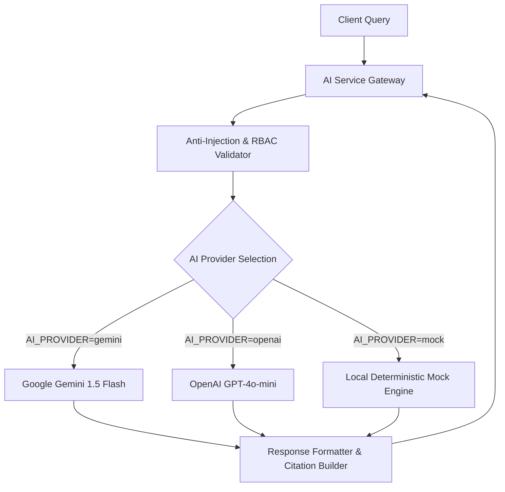

# CampusX AI & RAG Architecture Specification

## 1. Provider Abstraction

CampusX implements a vendor-neutral AI abstraction layer:



## 2. Retrieval-Augmented Generation (RAG) Pipeline

```text
Document Upload (PDF/Markdown) 
  ↓
Text Extraction & Normalization
  ↓
Chunking (Recursive character splitting, chunk_size=500, overlap=50)
  ↓
Embedding Generation (sentence-transformers or OpenAI/Gemini Embeddings)
  ↓
Vector Storage (PostgreSQL pgvector or FAISS CPU)
  ↓
Semantic Similarity Search (Cosine distance, top_k=4)
  ↓
Context Construction + System Constraints
  ↓
Ground-Truth AI Generation
```

## 3. Anti-Hallucination & Safety Principles

1. **Evidence Grounding**: The AI model is strictly instructed to reference retrieved database records and chunks.
2. **Defensive Fallback**: If the required knowledge base or student records are absent, the system responds:
   > *"Insufficient data available for this analysis."*
   or
   > *"I could not find this information in the available campus knowledge base."*
3. **Prompt Injection Defense**: System prompts use separate delimiters; user-supplied content is escaped and treated as inert data.
4. **Credential Redaction**: Prompts and responses undergo regex scrubbing to ensure no JWT tokens, hashed passwords, or API keys are ever leaked.
