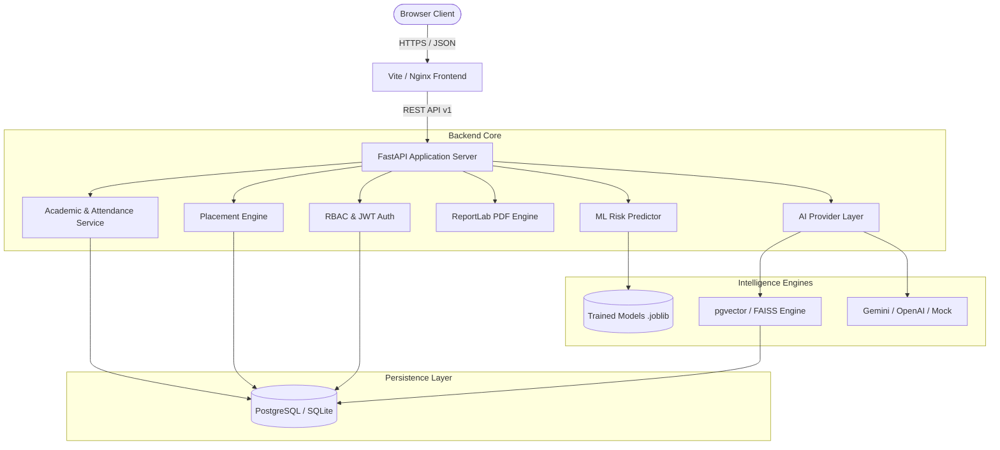

# CampusX System Architecture Specification

## 1. Overview

CampusX is designed as a modular, three-tier enterprise web application with dedicated analytical and AI intelligence pipelines:

1. **Client Tier**: Single Page Application built with React 18+, Vite, TypeScript, and Tailwind CSS.
2. **Application Tier**: High-performance RESTful API powered by Python 3.12+ and FastAPI.
3. **Data & Storage Tier**: PostgreSQL 16 (Primary) with pgvector, with a deterministic SQLite fallback mechanism for development.
4. **Intelligence Tier**: Machine Learning pipelines for predictive student risk assessment and an isolated AI Provider layer supporting RAG.

## 2. Key Architectural Decisions

### 2.1 Deterministic Storage Resolution
To prevent path divergence and accidental multi-database instantiation when launching the app from different working directories, database paths are anchored absolutely via `BASE_DIR = Path(__file__).resolve().parent.parent.parent`.

### 2.2 Role-Based Data Isolation (Anti-IDOR)
Data isolation is strictly enforced at the database query layer:
- **Students**: Filtered strictly by authenticated `student.user_id == current_user.id`.
- **Faculty**: Filtered by assigned courses and sections (`course_faculty.faculty_id == current_user.id`).
- **Placement Officers**: Authorized for drives, eligibility queries, and placement funnels.
- **Admin / Management**: Aggregated statistics and institutional records.

### 2.3 Swappable AI Engine
The AI system operates behind a unified interface (`BaseAIProvider`). The runtime selects either Google Gemini, an OpenAI-compatible endpoint, or an offline Mock provider based on the configured environment.
