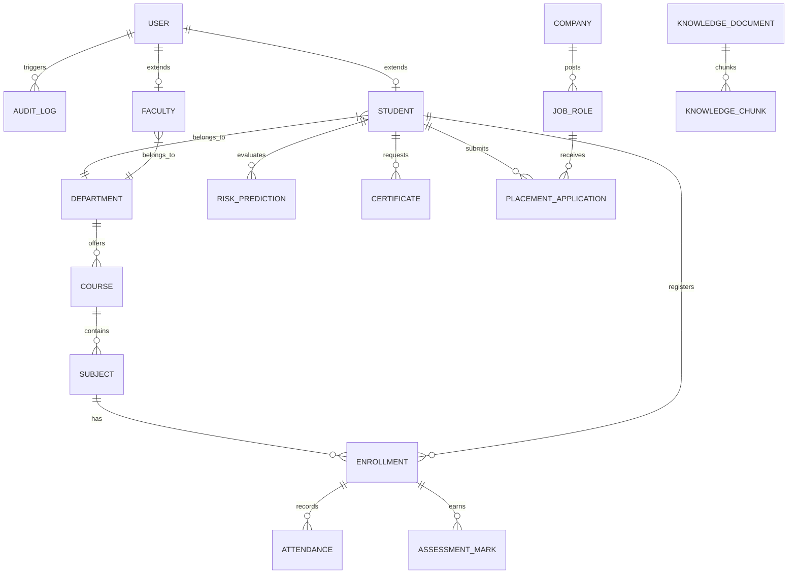

# CampusX Database Architecture & Schema Specification

## 1. Primary & Fallback Strategy

CampusX uses **PostgreSQL 16** as its primary production and container database.
For local lightweight development, a **deterministic SQLite fallback** is supported:
- Target path: `backend/data/campusx.db` (resolved absolutely via `app.core.config.BASE_DIR`).
- Relative path discrepancies across commands, directories, and workers are completely prevented.

## 2. Core Entity Relationship Model

## 3. Planned Database Tables (Phase 2+)

1. **users**: `id`, `email`, `password_hash`, `role`, `full_name`, `is_active`, `created_at`, `updated_at`
2. **students**: `id`, `user_id`, `student_id_code`, `department_id`, `program`, `semester`, `section`, `admission_year`, `cgpa`, `attendance_pct`
3. **faculty**: `id`, `user_id`, `faculty_code`, `department_id`, `designation`, `specialization`
4. **departments**: `id`, `code`, `name`, `head_of_department_id`
5. **courses**: `id`, `code`, `name`, `credits`, `department_id`
6. **subjects**: `id`, `code`, `name`, `course_id`, `semester`, `faculty_id`
7. **enrollments**: `id`, `student_id`, `subject_id`, `academic_year`, `status`
8. **attendance**: `id`, `enrollment_id`, `date`, `status` (Present/Absent/Excused), `recorded_by`
9. **assessments**: `id`, `subject_id`, `title`, `type` (Midterm, Internal, Final, Practical), `max_marks`, `weightage`
10. **marks**: `id`, `assessment_id`, `student_id`, `score`, `feedback`, `graded_by`
11. **risk_predictions**: `id`, `student_id`, `risk_level`, `confidence`, `contributing_factors`, `model_version`, `created_at`
12. **notices**: `id`, `title`, `content`, `category`, `priority`, `target_role`, `is_pinned`, `publish_date`, `expiry_date`
13. **events**: `id`, `title`, `description`, `category`, `venue`, `event_date`, `max_participants`
14. **event_registrations**: `id`, `event_id`, `student_id`, `registration_date`, `status`
15. **certificates**: `id`, `certificate_uuid`, `student_id`, `type`, `status` (Pending/Approved/Rejected), `file_path`, `qr_code_data`
16. **companies**: `id`, `name`, `website`, `tier`, `contact_email`
17. **job_roles**: `id`, `company_id`, `title`, `package_lpa`, `min_cgpa`, `required_skills`, `deadline`
18. **placement_applications**: `id`, `job_role_id`, `student_id`, `status`, `interview_date`
19. **skills**: `id`, `name`, `category`
20. **student_skills**: `id`, `student_id`, `skill_id`, `proficiency`
21. **knowledge_documents**: `id`, `title`, `category`, `file_path`, `uploaded_by`, `created_at`
22. **knowledge_chunks**: `id`, `document_id`, `content`, `embedding`, `chunk_index`
23. **audit_logs**: `id`, `user_id`, `action`, `resource`, `ip_address`, `timestamp`, `metadata`
24. **notifications**: `id`, `user_id`, `title`, `message`, `type`, `is_read`, `created_at`
