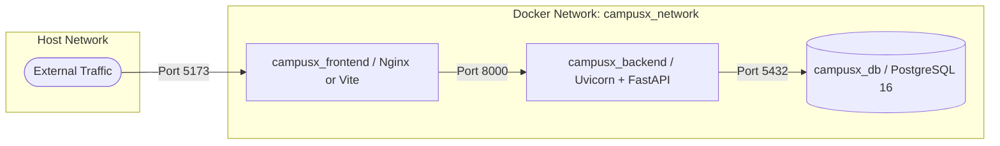

# CampusX Deployment & Operations Specification

## 1. Container Architecture

CampusX is designed to deploy seamlessly via Docker and Docker Compose:



## 2. Launching with Docker Compose

```bash
# 1. Clone repository & configure environment variables
cp .env.example .env

# 2. Build and start containers
docker compose up -d --build

# 3. View container health status
docker compose ps
```

## 3. Health Checks & Resiliency
- **PostgreSQL**: Health check executes `pg_isready -U postgres -d campusx_db` every 10 seconds.
- **Backend API**: Depends on database health condition; exposes `/health` endpoint.
- **Frontend**: Depends on backend container; proxies `/api` requests to `http://backend:8000`.
